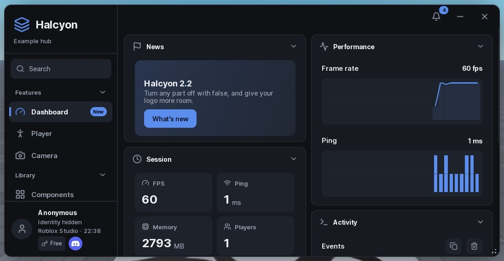
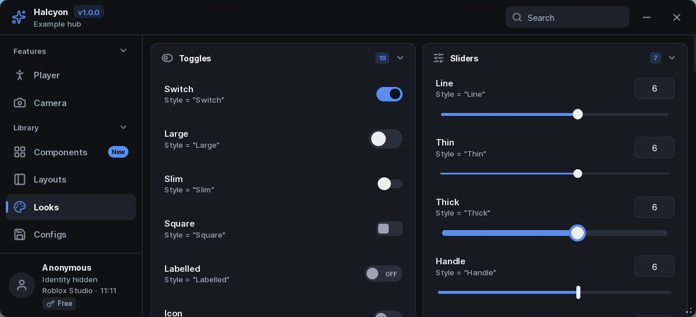
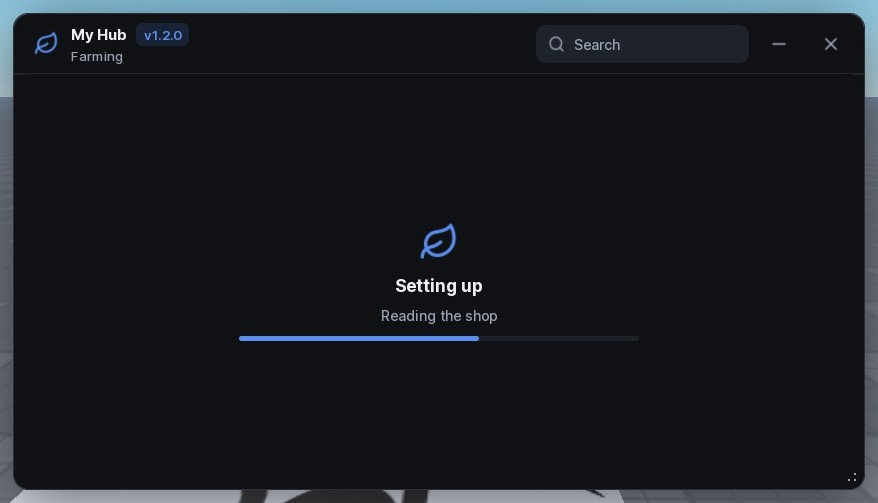
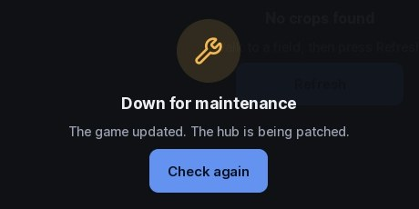
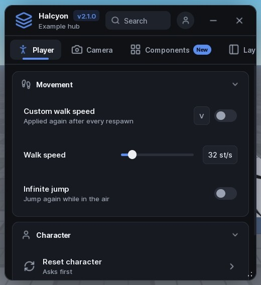

# Halcyon

A UI library for Roblox script hubs. One file, loaded with `loadstring`, that gives you a window with tabs, sections and 43 controls, a named look for every one of them, presets, a key system with tiers, saved configs, sixteen themes the player can extend, six icon packs, and a layout that reflows from a desktop monitor down to a phone. Every built-in part turns on or off with `true` or `false`.


Docs and a tour of every look: https://scriptsfordays.github.io/Halcyon-Docs/ (the site has [its own repo](https://github.com/ScriptsForDays/Halcyon-Docs), so this one stays all Luau).

## Try it

Run the example in your executor. It opens a hub that uses every control:

```lua
loadstring(game:HttpGet("https://raw.githubusercontent.com/ScriptsForDays/Halcyon/main/example/Example.luau"))()
```

The example opens on its key prompt. **Keyless** needs no key; the demo keys are `HALCYON-FREE` and `HALCYON-PAID`.

No executor to hand? The same example runs in your browser at https://scriptsfordays.github.io/Halcyon-Docs/play.html. It runs the real library code in a Luau runtime and draws it with HTML, so spacing and fonts can differ a little from Roblox.

## Use it

```lua
local Halcyon = loadstring(game:HttpGet("https://raw.githubusercontent.com/ScriptsForDays/Halcyon/main/dist/Halcyon.luau"))()

local Window = Halcyon:CreateWindow({
	Title = "My Hub",
	Subtitle = "Universal",
	Version = "v1.0.0", -- the tag beside the title; ShowVersion = false hides it
	Icon = "gamepad-2",
	Folder = "MyHub", -- configs and settings save under Halcyon/MyHub/
})

local Player = Window:Tab({ Title = "Player", Icon = "user" })
local Movement = Player:Section({ Title = "Movement" })

Movement:Toggle({
	Title = "Fly",
	Description = "WASD to steer, Space and Shift to climb",
	Flag = "Fly", -- saved in configs; also Window.Flags.Fly
	Callback = function(enabled)
		-- your code
	end,
})

Movement:Slider({
	Title = "Walk speed",
	Min = 16,
	Max = 120,
	Default = 32,
	Flag = "WalkSpeed",
	Callback = function(speed) end,
})

Window:SettingsTab() -- themes, menu key, configs, unload
Window:LoadAutoload() -- loads the config the player marked, if any
```

`RightShift` shows and hides the window, or folds it to its pill or chip when the hub minimises to one. On a phone, a round button takes its place.

## What is in it

| | |
|---|---|
| **Looks** | Every control has named looks: 10 toggles, 7 sliders, 8 buttons with 7 effects, 4 inputs, 4 dropdowns, 7 sections, 6 tab markers, 4 window surfaces, 7 open animations, 10 notices. Pick per element, per window, or with a preset (Classic, Minimal, Glass, Neon, Compact) |
| **Controls** | Button (hold to confirm, press twice, loading and done states, its own key), Buttons in a row, MenuButton, Toggle (exclusive groups, confirm before turning on), Knob, Slider (prefix, percent, ticks, range), Dropdown (icons, descriptions, headings, player lists, chips, inline), List (pick, multi-pick, search, drag to reorder), Tags, Radio, Checklist, Chips, Tiles, Input (password, multi-line, counter, clear, validation), Keybind (mode picker, Ctrl/Shift/Alt combinations), ColorPicker (palette, recent, copy), DatePicker, Segmented, Stepper, Rating, Progress, Status, Countdown, Table, Accordion, Paragraph, callout Labels, Divider, Code, Image, Space, Link |
| **Dashboards** | Stat tiles and grids, gauges, live line, area and bar graphs, donut, pie, multi-line and grouped-bar charts with hover readouts, a log panel with level filters, a player list with your own row buttons, image banners, a 3D model preview |
| **Hub tools** | An inventory grid with pictures, counts and rarities; saved places with teleport; an update check; an executor support panel; an errors panel with tracebacks |
| **Layout** | Sub-pages with a breadcrumb, sections that pop out into their own resizable panel, moving backgrounds (aurora, gradient, mesh, lines) for the window and sections, four navigation styles, four header styles (one puts a big logo above the sidebar), tabs inside sections, a header switch per section, two or three controls on one line, side sheets, sections that scroll past a height, page headers and notices, one or two columns, collapsible sections and sidebar groups, three ways to minimise, edge snapping |
| **Switches** | Every built-in part on or off with `true` or `false`, live with `Window:Set`; any tab, section or row hidden, greyed or tied to another control with `Visible`, `Disabled`, `ShowWhen` and `EnableWhen` |
| **Key system** | Tiers such as Free and Paid, or your own; listed keys, your own validator or your own server; ad-service confirmation for free keys; saved keys with an expiry countdown; rows and whole sections locked to a tier or to paid keys |
| **Feedback** | Ten notice looks with buttons and an optional chime; countdowns as a bar, a draining outline or a ring; notices that update in place by Id, fold repeats into a count, show pictures, pile into a deck, pause while hovered, swipe away, and keep a history behind a bell. A failing callback shows its reason on its row. Hover tips on any row, right-click menus on any row, one-time spotlights on new features, dialogs with countdown buttons, a Ctrl+K command palette, a watermark, a keybind list and a floating quick bar |
| **For hub code** | A real-progress loading screen, a What's new card shown once per version, an About section, empty and error states, a lock screen, row badges and info tips, `Requires`, tab badges, a config section, a two-step unload |
| **Saving** | Configs for every flagged control, autoload, configs per game, share codes that work without file functions, undo, and the player's own interface choices |
| **Players' own** | Favourites tab of starred rows, tabs they drag into their own order, nine languages for the built-in text |
| **Personalisation** | Players pick font, text size, corners, spacing, window transparency, notice position, a gradient accent and colour-blind-friendly status colours, and build, save and share their own themes |
| **Profile** | Avatar (headshot or 3D viewport), name, tier, executor, date and time, with an anonymous mode |
| **Search** | One box that filters every tab and page, marks the matching words, counts matches, and steps through them with Enter or the arrow keys |
| **For developers** | `Debug = true` names misspelt options with a guess; `RegisterElement` for your own controls; `Build` for a whole hub from one table; Luau types in `dist/Halcyon.types.luau`; LLM.txt written for AI assistants |
| **Access** | Gamepad and keyboard focus ring, 44 px touch targets, larger text, reduced motion |


## Every switch

Each built-in part is one option. Leave it out for the default, set it to `false` to leave the part out, or `true` to add it. Some take a table of settings in place of `true`.

```lua
local Window = Halcyon:CreateWindow({
	Title = "My Hub",
	Search = false,
	Close = false,
	NotificationCenter = true,
	Watermark = true,
	KeybindList = { Style = "Glass" },
	SettingsTab = { Group = "Hub" },
})

Window:Set("Search", true) -- flip a switch while the hub runs
print(Window:Get("Shadow")) --> true
```

| Switch | Default | What it controls |
|---|---|---|
| `Search` | on | The search box |
| `Profile` | on | The profile card. A table sets its options |
| `ShowVersion` | on | The version tag beside the title |
| `Minimize` | on | The minimise button. `Minimizable` still works |
| `Close` | on | The close button |
| `Resize` | on | The resize grip. `Resizable` still works |
| `Drag` | on | Dragging the window by its top bar |
| `Shadow` | on | The soft shadow under the window |
| `Tooltips` | on | Hover tips on rows |
| `Animations` | on | Motion. Off is the same as reduced motion |
| `Blur` | off | Blurs the game behind the open window. A number sets how much |
| `CommandPalette` | off | Ctrl+K search over every tab and setting |
| `NotificationCenter` | off | A bell in the top bar with an unread count and the notices so far |
| `Watermark` | off | A small bar with the title, executor and time. A table picks the fields |
| `KeybindList` | off | A list of bound keys and which are active |
| `SettingsTab` | off | The ready-made settings tab |
| `Snap` | off | Snapping the window to screen edges |
| `OpenButton` | off | A round button to reopen the hidden window on desktop. Phones always get it |

These are read when the window is made: `Icon`, `TopbarImage` and `Logo` (`false` leaves the picture out), `CollapsibleGroups`, `SliderTooltips`, `ToggleOutline`, `ConfirmUnload`, `LockShimmer`, `FocusRing` and `SavePreferences`. `Halcyon:GetSwitches()` lists every name `Window:Set` takes.

Tabs, sections and rows have switches of their own:

```lua
Tab:Toggle({ Title = "Silent aim", Visible = false }) -- made, but hidden
Tab:Slider({ Title = "Radius", Disabled = true }) -- greyed out
Tab:Slider({ Title = "Fly speed", ShowWhen = "Fly" }) -- shown while the Fly toggle is on
Tab:Dropdown({ Title = "Target", EnableWhen = { "Mode", "Manual" } }) -- usable while Mode is "Manual"
Window:Tab({ Title = "Admin", ShowWhen = "AdminMode" })
```

`Window:SettingsTab({ Accent = false, Scale = false, Unload = false })` leaves rows out of the settings tab. The full list of options is in [docs/api.md](docs/api.md).

## Headers and logos

`HeaderStyle` decides where the title and logo go:

| HeaderStyle | Layout |
|---|---|
| `Bar` (default) | The top bar: icon or picture, title, subtitle and version tag |
| `Tall` | A taller top bar with a larger picture beside the title |
| `Wordmark` | A wide logo image in place of the title words |
| `Sidebar` | A big logo at the top of the sidebar with search under it, and no top bar. The logo drags the window |

```lua
Halcyon:CreateWindow({
	Title = "Butter",
	HeaderStyle = "Sidebar",
	Logo = "rbxassetid://1234567", -- any image source, or { Image, Text, Icon, Height }
})
```

Without an image, `Logo` draws the title as a large wordmark, so it works in Studio and on executors without `getcustomasset`. `Logo = false`, `Icon = false` and `TopbarImage = false` leave each picture out. On a narrow window the `Sidebar` style moves the logo back into a top bar. The example's **Looks** tab can rebuild the hub in each style.



## Looks and presets

Defaults look the same as Halcyon 1.0. Opt into a look per element, per window, or all at once:

```lua
local Window = Halcyon:CreateWindow({
	Title = "My Hub",
	Preset = "Glass", -- Classic, Minimal, Glass, Neon, Compact
	Styles = { Toggle = "Slim", Slider = "Thick" }, -- wins over the preset
	TabIndicator = "Pill",
	OpenAnimation = "Rise",
	CommandPalette = true, -- Ctrl+K
})
Section:Toggle({ Title = "Fly", Style = "Labelled" }) -- one element's own look
```

The example's **Looks** tab lists every look with the line that turns it on, and can rebuild the hub in any preset so you can compare them. Every look and option is listed in [docs/styles.md](docs/styles.md).

| | |
|---|---|
|  |  |
|  |  |
|  |  |
|  |  |
|  |  |

## Key system

```lua
local Window = Halcyon:CreateWindow({
	Title = "My Hub",
	KeySystem = {
		Note = "Keys are posted in our Discord.",
		Tiers = {
			{ Name = "Free", Keys = { "FREE-2026" }, Link = "https://example.com/get-key", Duration = 86400 },
			{
				Name = "Paid",
				Link = "https://example.com/buy",
				Validate = function(key)
					return myServerSaysValid(key), "That key is not active."
				end,
			},
		},
	},
})
if not Window then
	return -- the player closed the prompt
end

Tab:Toggle({ Title = "Kill aura", PaidOnly = true }) -- locked unless the key is paid
Tab:Section({ Title = "Raids", PaidOnly = true, LockHint = "Buy a key in our Discord" }) -- one overlay over the section
```


A key with a `Duration` shows a countdown on the profile card; `ShowExpiry = false` in the `KeySystem` table hides it.

**Free** is a key the player earns, usually through your ad link, and can be tied to an ad service. **Keyless** needs no key: add a tier with `NoKey = true`, or leave the key system out and the window is Keyless. Rows can be locked to a tier, and the lock wording is yours to set. See [docs/key-system.md](docs/key-system.md).

> **A key prompt in a script is not security.** It runs on the player's machine, so anyone who reads the script can skip it. Halcyon's prompt is a gate for honest users. To protect a script, have your server hand it out only after the key is checked there.

## Themes

Midnight, Onyx, Rose, Aqua, Ember, Forest, Amethyst, Crimson, Glacier and Daylight are built in. Every one keeps its text at a contrast of 4.5 or more.

```lua
Halcyon:SetTheme("Rose")
Halcyon:SetAccent(Color3.fromRGB(255, 120, 40)) -- recolour the accent of any theme
Halcyon:AddTheme({ Name = "Mine", Base = "Midnight", accent = Color3.fromRGB(80, 220, 160) })
```


More in [docs/themes.md](docs/themes.md).

## Icons

Any `Icon` takes a Lucide name. Prefix a pack to use another set:

```lua
Icon = "rocket" -- Lucide
Icon = "solar:rocket-bold" -- Solar
Icon = "geist:arrow-up" -- Geist
Icon = 123456789 -- your own asset id
```

Each set's own site is the place to find names:

| Pack | Prefix | Browse it at |
|---|---|---|
| Lucide | none, or `lucide:` | [lucide.dev/icons](https://lucide.dev/icons/) |
| Solar | `solar:` | [icones.js.org/collection/solar](https://icones.js.org/collection/solar). Add the style to the name: `home-bold`, `home-linear` |
| Geist | `geist:` | [vercel.com/geist/icons](https://vercel.com/geist/icons) |
| Gravity UI | `gravity:` | [gravity-ui.com/icons](https://gravity-ui.com/icons) |
| Craft | `craft:` | [Craft Icons on Figma](https://www.figma.com/community/file/1415718327120418204). Add the style to the name: `rocket-stroke` |
| SF Symbols | `sfsymbols:` | [Apple's SF Symbols app](https://developer.apple.com/sf-symbols/). Names are camelCase: `house.and.flag.fill` is `houseAndFlagFill` |

The Roblox uploads of every pack come from [Footagesus/Icons](https://github.com/Footagesus/Icons), which lists the exact names in each one. 143 Lucide icons ship inside the library and draw at once; the rest of Lucide and the other packs load on first use and are cached on disk. More in [docs/icons.md](docs/icons.md).

## Phones and small screens

Below 560 px of window width the sidebar becomes a strip of tabs, two columns fold into one, wide controls drop under their titles, and the top-bar search folds into its magnifier until pressed. Touch targets grow to 40 px or more, and text never goes below 12 px. Nothing is hover-only: row menus open on a long press as well as a right-click.




## Details


- Running your hub twice replaces the first window instead of stacking a second.
- The window draws in the executor's hidden GUI container (`gethui`) at a DisplayOrder near the top of the range, so the game's own screens never cover it.
- Divider lines keep one weight at any interface scale and any position. A plain 1 px frame turns 1 or 2 pixels thick depending on where it lands once display scaling is involved; Halcyon draws dividers as outlines, which measured the same at every position in Studio.
- `Window:Unload()` removes every instance and connection the library made. `Window.OnUnload` is where your hub stops its own features.
- Without file functions (some executors, and Studio) nothing is saved, and the Settings tab says so. Nothing pretends to have saved.
- No per-frame work: dragging and sliders follow input events, and one loop a second drives every clock.

## Documentation

- [docs/api.md](docs/api.md): every option and method
- [docs/styles.md](docs/styles.md): every look, preset and personalisation setting
- [docs/key-system.md](docs/key-system.md): tiers, ad services, paid locks, your own server
- [docs/themes.md](docs/themes.md): palettes and custom themes
- [docs/icons.md](docs/icons.md): packs and custom icons
- [LLM.txt](LLM.txt): the whole API in one file, written for AI coding assistants
- [docs/llm-guide.md](docs/llm-guide.md): how an AI assistant should choose controls and lay out a hub

## In Roblox Studio

1. In **Explorer**, right-click **ReplicatedStorage**, choose **Insert from File...** and pick `dist/Halcyon.rbxmx`. It adds a `Halcyon` ModuleScript with its code split across child scripts, because Studio refuses a single script of 200,000 characters or more.
2. Under **StarterPlayer > StarterPlayerScripts**, add a **LocalScript** and paste in `example/Example.luau`.
3. Press **Play**.

Studio has no file functions and cannot fetch the full icon packs, so saving is off there and only the built-in Lucide icons draw.

## Development

```bash
node tools/bundle.mjs
```

```bash
node tools/test.mjs
```

`src/` holds the modules; `tools/bundle.mjs` joins them into `dist/Halcyon.luau`. The tests run headless under the standalone [`luau`](https://github.com/luau-lang/luau/releases) binary against engine stubs, and cover values, callbacks, saved data, key checks and unload. They cannot see pixels: the screenshots here come from Roblox Studio, and behaviour inside each executor is yours to confirm.

## License

[MIT](LICENSE). Icon credits are in [THIRD-PARTY-NOTICES.md](THIRD-PARTY-NOTICES.md).
