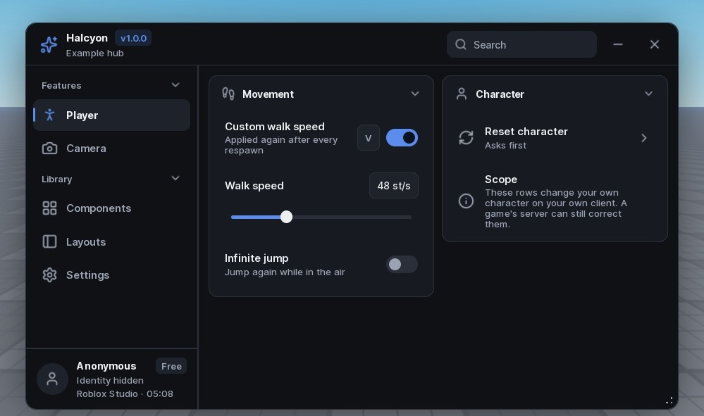
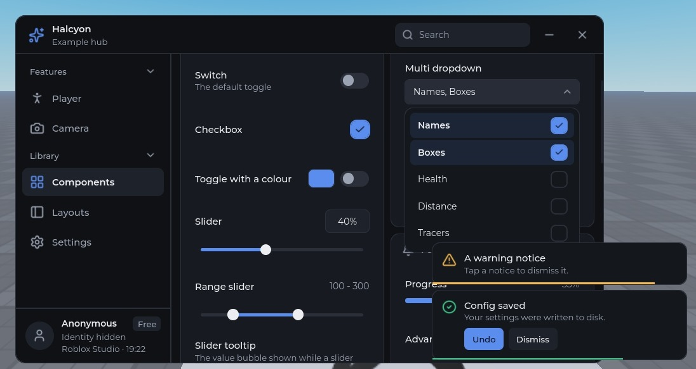
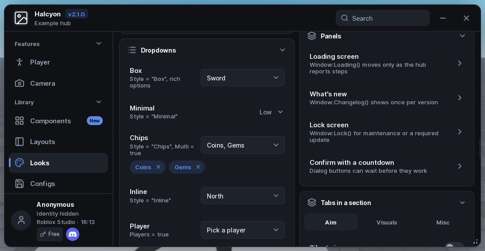
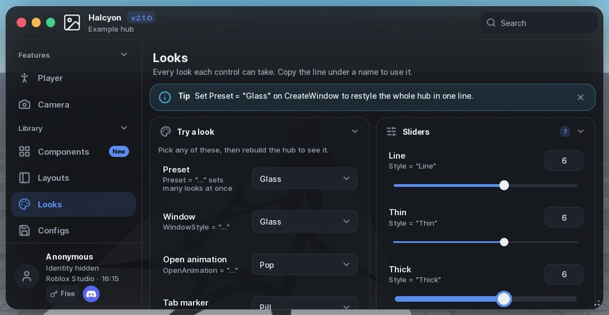
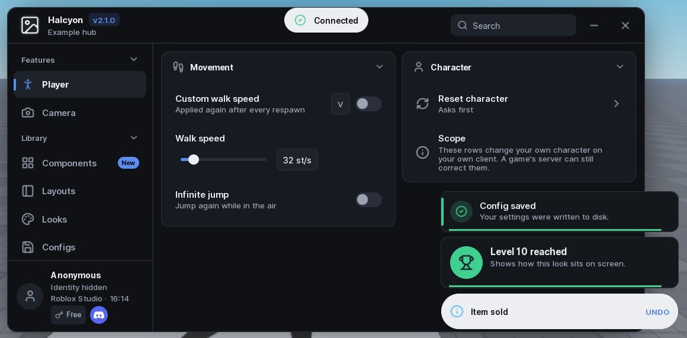
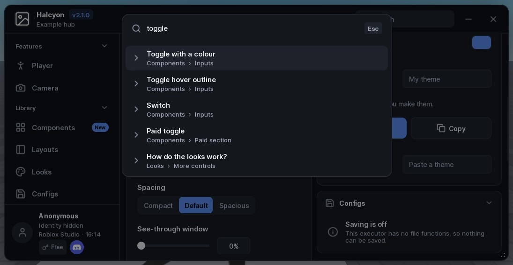
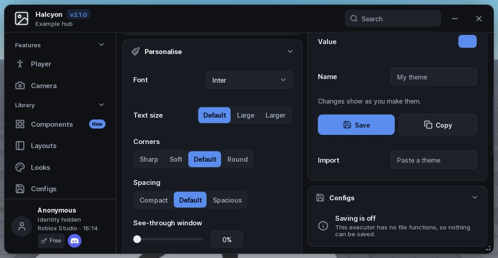
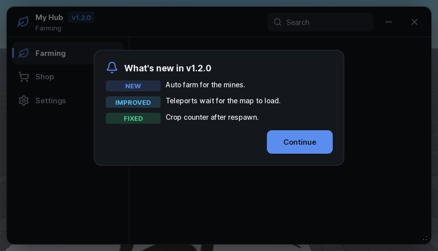
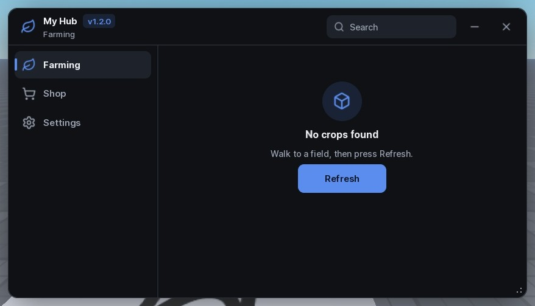
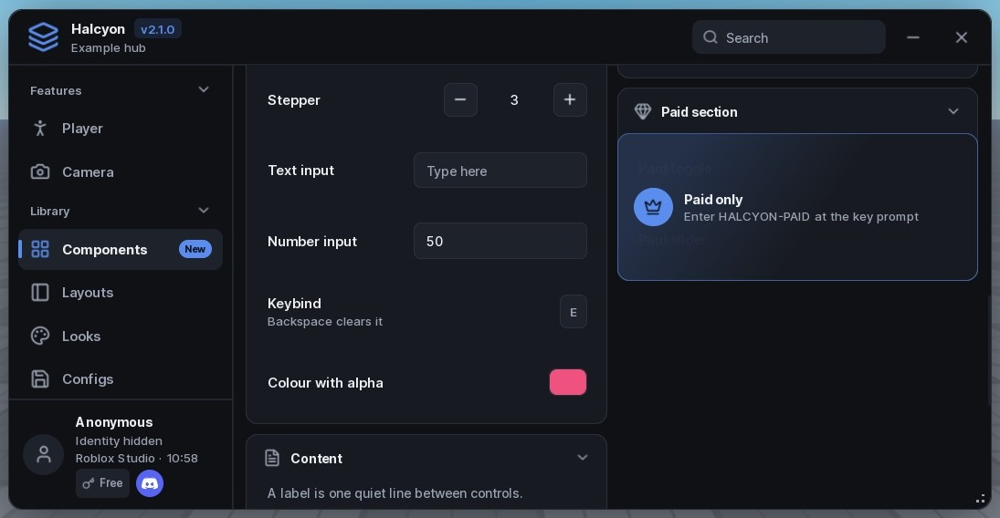

# Halcyon

A UI library for Roblox script hubs. One file, loaded with `loadstring`, that gives you a window with tabs, sections and 27 controls, a named look for every one of them, presets, a key system with tiers, saved configs, sixteen themes the player can extend, six icon packs, and a layout that reflows from a desktop monitor down to a phone.



## Try it

Run the example in your executor. It opens a hub that uses every control:

```lua
loadstring(game:HttpGet("https://raw.githubusercontent.com/ScriptsForDays/Halcyon/main/example/Example.luau"))()
```

The example opens on its key prompt. **Keyless** needs no key; the demo keys are `HALCYON-FREE` and `HALCYON-PAID`.

## Use it

```lua
local Halcyon = loadstring(game:HttpGet("https://raw.githubusercontent.com/ScriptsForDays/Halcyon/main/dist/Halcyon.luau"))()

local Window = Halcyon:CreateWindow({
	Title = "My Hub",
	Subtitle = "Universal",
	Version = "v1.0.0", -- the tag beside the title; ShowVersion = false hides it
	Icon = "gamepad-2",
	Folder = "MyHub", -- configs and settings save under Halcyon/MyHub/
})

local Player = Window:Tab({ Title = "Player", Icon = "user" })
local Movement = Player:Section({ Title = "Movement" })

Movement:Toggle({
	Title = "Fly",
	Description = "WASD to steer, Space and Shift to climb",
	Flag = "Fly", -- saved in configs; also Window.Flags.Fly
	Callback = function(enabled)
		-- your code
	end,
})

Movement:Slider({
	Title = "Walk speed",
	Min = 16,
	Max = 120,
	Default = 32,
	Flag = "WalkSpeed",
	Callback = function(speed) end,
})

Window:SettingsTab() -- themes, menu key, configs, unload
Window:LoadAutoload() -- loads the config the player marked, if any
```

`RightShift` shows and hides the window. On a phone, a round button takes its place.

## What is in it

| | |
|---|---|
| **Looks** | Every control has named looks: 10 toggles, 7 sliders, 8 buttons with 7 effects, 4 inputs, 4 dropdowns, 7 sections, 6 tab markers, 4 window surfaces, 7 open animations, 10 notices. Pick per element, per window, or with a preset (Classic, Minimal, Glass, Neon, Compact) |
| **Controls** | Button (hold to confirm, press twice, loading and done states), Buttons in a row, Toggle, Slider (prefix, percent, ticks, range), Dropdown (icons, descriptions, headings, player lists, chips, inline), Radio, Checklist, Chips, Tiles, Input (password, multi-line, counter, clear), Keybind (mode picker), ColorPicker (palette, recent, copy), DatePicker, Segmented, Stepper, Rating, Progress, Status, Countdown, Table, Accordion, Paragraph, callout Labels, Divider, Code, Image, Space |
| **Layout** | Four navigation styles, tabs inside sections, a header switch per section, sections that scroll past a height, `ShowWhen` dependencies, page headers and notices, one or two columns, collapsible sections and sidebar groups, three ways to minimise, edge snapping |
| **Key system** | Tiers such as Free and Paid, or your own; listed keys, your own validator or your own server; ad-service confirmation for free keys; saved keys with an expiry countdown; rows and whole sections locked to a tier or to paid keys |
| **Feedback** | Ten notice looks with buttons and an optional chime, hover tips on any row, one-time spotlights on new features, dialogs with countdown buttons, a Ctrl+K command palette, a watermark and keybind list in several looks |
| **For hub code** | A real-progress loading screen, a What's new card shown once per version, an About section, empty and error states, a lock screen, row badges and info tips, `Requires`, tab badges, a config section, a two-step unload |
| **Saving** | Configs for every flagged control, autoload, and the player's own interface choices |
| **Personalisation** | Players pick font, text size, corners, spacing, window transparency, notice position, a gradient accent and colour-blind-friendly status colours, and build, save and share their own themes |
| **Profile** | Avatar (headshot or 3D viewport), name, tier, executor, date and time, with an anonymous mode |
| **Search** | One box that filters every tab, matches tab names and marks the matching words |
| **Access** | Gamepad and keyboard focus ring, 44 px touch targets, larger text, reduced motion |



## Turning things on and off

Most features are one option. Leave it out for the default, or set it to `false`:

```lua
Halcyon:CreateWindow({
	Title = "My Hub",
	ShowVersion = false, -- no version tag beside the title
	Shadow = false, -- no soft shadow under the window
	ButtonEffect = "None", -- or "Sweep" (default), "Ripple", "Lift", "Glow"
	Search = false, -- no search box
	Profile = false, -- no profile card
	Resizable = false, -- no resize grip
	Minimizable = false, -- no minimise button
	CollapsibleGroups = false, -- sidebar group headings do not fold
	SliderTooltips = false, -- no value bubble while dragging a slider
	ToggleOutline = false, -- no outline around a toggle on hover
	SavePreferences = false, -- do not remember the player's interface choices
})

Window:SettingsTab({ Accent = false, Scale = false, Unload = false }) -- leave rows out of the Settings tab
```

The full list is in [docs/api.md](docs/api.md).

## Looks and presets

Defaults look the same as Halcyon 1.0. Opt into a look per element, per window, or all at once:

```lua
local Window = Halcyon:CreateWindow({
	Title = "My Hub",
	Preset = "Glass", -- Classic, Minimal, Glass, Neon, Compact
	Styles = { Toggle = "Slim", Slider = "Thick" }, -- wins over the preset
	TabIndicator = "Pill",
	OpenAnimation = "Rise",
	CommandPalette = true, -- Ctrl+K
})
Section:Toggle({ Title = "Fly", Style = "Labelled" }) -- one element's own look
```

The example's **Looks** tab lists every look with the line that turns it on, and can rebuild the hub in any preset so you can compare them. Every look and option is listed in [docs/styles.md](docs/styles.md).

| | |
|---|---|
|  |  |
|  |  |
|  |  |
|  |  |
|  |  |

## Key system

```lua
local Window = Halcyon:CreateWindow({
	Title = "My Hub",
	KeySystem = {
		Note = "Keys are posted in our Discord.",
		Tiers = {
			{ Name = "Free", Keys = { "FREE-2026" }, Link = "https://example.com/get-key", Duration = 86400 },
			{
				Name = "Paid",
				Link = "https://example.com/buy",
				Validate = function(key)
					return myServerSaysValid(key), "That key is not active."
				end,
			},
		},
	},
})
if not Window then
	return -- the player closed the prompt
end

Tab:Toggle({ Title = "Kill aura", PaidOnly = true }) -- locked unless the key is paid
Tab:Section({ Title = "Raids", PaidOnly = true, LockHint = "Buy a key in our Discord" }) -- one overlay over the section
```




A key with a `Duration` shows a countdown on the profile card; `ShowExpiry = false` in the `KeySystem` table hides it.

**Free** is a key the player earns, usually through your ad link, and can be tied to an ad service. **Keyless** needs no key: add a tier with `NoKey = true`, or leave the key system out and the window is Keyless. Rows can be locked to a tier, and the lock wording is yours to set. See [docs/key-system.md](docs/key-system.md).

> **A key prompt in a script is not security.** It runs on the player's machine, so anyone who reads the script can skip it. Halcyon's prompt is a gate for honest users. To protect a script, have your server hand it out only after the key is checked there.

## Themes

Midnight, Onyx, Rose, Aqua, Ember, Forest, Amethyst, Crimson, Glacier and Daylight are built in. Every one keeps its text at a contrast of 4.5 or more.

```lua
Halcyon:SetTheme("Rose")
Halcyon:SetAccent(Color3.fromRGB(255, 120, 40)) -- recolour the accent of any theme
Halcyon:AddTheme({ Name = "Mine", Base = "Midnight", accent = Color3.fromRGB(80, 220, 160) })
```


More in [docs/themes.md](docs/themes.md).

## Icons

Any `Icon` takes a Lucide name. Prefix a pack to use another set:

```lua
Icon = "rocket" -- Lucide
Icon = "solar:rocket-bold" -- Solar
Icon = "geist:arrow-up" -- Geist; also craft:, gravity:, sfsymbols:
Icon = 123456789 -- your own asset id
```

143 Lucide icons ship inside the library and draw at once. The full packs load on first use and are cached on disk. More in [docs/icons.md](docs/icons.md).

## Phones and small screens

Below 560 px of window width the sidebar becomes a strip of tabs, two columns fold into one, and wide controls drop under their titles. Touch targets grow to 40 px or more, and text never goes below 12 px. Nothing is hover-only.


## Details


- Running your hub twice replaces the first window instead of stacking a second.
- The window draws in the executor's hidden GUI container (`gethui`) at a DisplayOrder near the top of the range, so the game's own screens never cover it.
- Divider lines keep one weight at any interface scale and any position. A plain 1 px frame turns 1 or 2 pixels thick depending on where it lands once display scaling is involved; Halcyon draws dividers as outlines, which measured the same at every position in Studio.
- `Window:Unload()` removes every instance and connection the library made. `Window.OnUnload` is where your hub stops its own features.
- Without file functions (some executors, and Studio) nothing is saved, and the Settings tab says so. Nothing pretends to have saved.
- No per-frame work: dragging and sliders follow input events, and one loop a second drives every clock.

## Documentation

- [docs/api.md](docs/api.md): every option and method
- [docs/styles.md](docs/styles.md): every look, preset and personalisation setting
- [docs/key-system.md](docs/key-system.md): tiers, ad services, paid locks, your own server
- [docs/themes.md](docs/themes.md): palettes and custom themes
- [docs/icons.md](docs/icons.md): packs and custom icons
- [LLM.txt](LLM.txt): the whole API in one file, written for AI coding assistants
- [docs/llm-guide.md](docs/llm-guide.md): how an AI assistant should choose controls and lay out a hub

## In Roblox Studio

1. In **Explorer**, right-click **ReplicatedStorage**, choose **Insert from File...** and pick `dist/Halcyon.rbxmx`. It adds a `Halcyon` ModuleScript with its code split across child scripts, because Studio refuses a single script of 200,000 characters or more.
2. Under **StarterPlayer > StarterPlayerScripts**, add a **LocalScript** and paste in `example/Example.luau`.
3. Press **Play**.

Studio has no file functions and cannot fetch the full icon packs, so saving is off there and only the built-in Lucide icons draw.

## Development

```bash
node tools/bundle.mjs
```

```bash
node tools/test.mjs
```

`src/` holds the modules; `tools/bundle.mjs` joins them into `dist/Halcyon.luau`. The tests run headless under the standalone [`luau`](https://github.com/luau-lang/luau/releases) binary against engine stubs, and cover values, callbacks, saved data, key checks and unload. They cannot see pixels: the screenshots here come from Roblox Studio, and behaviour inside each executor is yours to confirm.

## License

[MIT](LICENSE). Icon credits are in [THIRD-PARTY-NOTICES.md](THIRD-PARTY-NOTICES.md).
